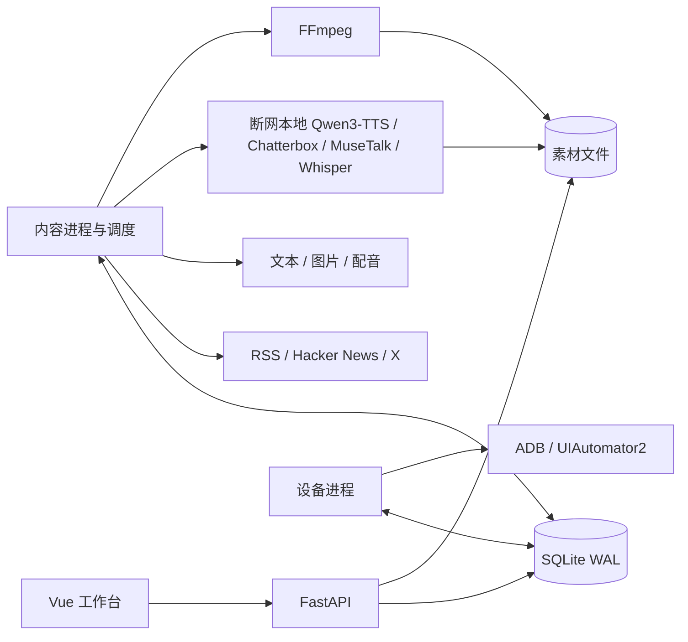

# V1 技术架构与接口边界

## 结构

`frontend/` 是中文 Vue 3 工作台；`backend/app/api.py` 提供 `/api/v1`；`worker.py` 运行内容和设备队列；`workflow.py` 串联领域步骤。SQLite 是业务与任务的唯一事实来源，本地文件是不可变素材。没有引入额外数据库、消息队列或云托管。

## 数据与状态

记录覆盖来源、选题、Production Brief、内容与版本、素材、质量报告、任务与步骤、审核与结构化合规、设备账号、发布、指标、经营实验、报告、模板版本及计划。首次迁移创建本地表；后续迁移保留模板历史并增加 V2 生产质量与经营数据。

- 内容：`DRAFT → GENERATING → REVIEW_REQUIRED → APPROVED/REJECTED`。所有编辑使用版本检查；旧客户端编辑返回 409。
- 任务：`QUEUED / RUNNING / WAITING_USER / SUCCEEDED / FAILED / CANCELED`。同一队列同一时间只执行一个任务。
- 发布：`PREPARING / WAITING_USER / VERIFYING / PUBLISHED / NEEDS_ATTENTION / CANCELED`。
- 模型调用记录保留每次尝试、请求指纹、用量和结果状态。已放弃的未知请求仍不可重发。
- Brief 是可选的创意 Gate。某内容一旦生成三个方案，选定方案前禁止继续生成脚本或审核；在非空内容上重新生成 Brief 会先冻结旧 revision 并升版本，不修改历史发布快照或删除素材。
- 每个当前版本视频对应唯一质量报告。`PASS / REVISE / FAIL` 只绑定 `content_id + version + video_asset_id`，旧视频的 PASS 不能放行新视频。

SQLite 短写事务使用 `BEGIN IMMEDIATE` 保护“检查并更新”；HTTP、FFmpeg 和设备操作不占用数据库写事务。任务租约持续更新，意外退出后区分安全可恢复步骤与结果未知的外部请求。指标与报告的记录和任务检查点同事务提交，恢复不重复入库。

审核快照绑定内容版本、成片及平台文案。发布使用当前审核快照，同一内容/账号/平台的已发布或有效任务不能重复建立。设备预留跨进程和等待状态持久化，取消只结束本地流程。

自动发布按设置显式开启。审核写入与两个已绑定平台的任务创建在同一事务内；相同手机由设备进程领取任务时逐条预留，上一条未解除占用时后一条继续排队。最终提交前保存 `submit_started_at`，真正的最终控件点击后保存 `submit_clicked_at`。小红书 9.46 会先点“发笔记”，再在内容来源声明中唯一选择“含 AI 合成内容”并点“确认并发布”；中间状态不匹配就停止。只有成功页面、发布快照中的平台标题与新复制作品链接一致时记录 `PUBLISHED`；其他结果进入 `VERIFYING`，重启和重试不会再次提交。小红书隐藏文件名时，允许在操作员核对哈希、时长和预览后写入一次可审计的素材确认；该确认不等于提交。手动发布或自动结果待核验时，可让手机停留在目标作品详情页：服务端核对账号、App、平台标题和唯一分享链接后原子写入 `PUBLISHED`。官方 `xhslink.cn/.com` 短链继续经公网 DNS/SSRF/跳转校验，持久化前去除分享追踪查询参数。

## 模型与媒体

`protocols.py` 仅构造协议和解析响应；`providers.py` 管理凭据、次数上限、请求意图、租约检查、缓存与结果不明状态。接口地址、模型名和协议都由配置决定，不按字符串静默替换服务或模型。

生成脚本前保存来源证据与模板输入快照。RSS 摘要不足时只读取被选中的那篇公开原文，不递归抓站。来源和模型输出仅作为数据，不具备执行权限。模型声明的事实不会被自动标记为人工核实。

X 来源可选公开时间线 `x` 或 TikHub `x_tikhub`，规范化为账号主页；读取近 30 天科技/AI 帖子，保留实际作者、原帖链接和完整长文。公开时间线仅访问固定的官方 syndication 接口；TikHub 固定读取 `fetch_user_post_tweet` 的一页。短帖不触发额外网页抓取。公开路径限流、API 拒绝和解析失败会明确显示，不伪造选题或切换提供商。

TikHub 凭据仅从本机环境读取。每次人工采集确认绑定 `expected_kind`，任务冻结账号与来源类型，避免旧免费任务在配置变化后转为付费请求。`providers.py` 复用调用记录与每日额度，先保存发送意图，成功响应先缓存再解析；解析修复后可以复用同任务已保存的数据。拒绝需显式重试，5xx 或读取结果未知进入核验状态；不自动重发、不自动翻页。只记录受限错误分类，不保存任意错误响应文本或密钥。

文案生成提示同时约束标题、描述、旁白、画面文字和图片提示词遵守现行法律与抖音、小红书平台规范。抖音标题上限为 30 个中文字符（或 60 个半角字符），小红书为 20（或 40）；两平台描述与话题合计上限 1000 字符。模型输出、草稿保存、人工审核与入队发布共用同一服务端规则；审核要求两端描述保留 AI 辅助制作标识，并由人工明确确认语义与素材合规。字数和必填项可由程序硬性阻断；语义合规仍以人工复核为最终发布门槛，不把关键词匹配当作法律判定。

图片输出下载、图片解码与配音校验成功后才登记为产物。方舟 `watermark=false` 的提示词同时预留底部安全区；若服务商仍叠加右下角字样，入库前使用紧邻安全区的镜像模糊纹理替换最下方 8%，不拉伸、不改变分辨率，且只在用户明确关闭方舟水印时执行。视频默认保持自然语速，按真实音频时长生成字幕；显式选择匹配目标时长时才变速并同步字幕。关键词使用镜头里的字面短语，先按纯文本换行再插入受控 ASS 颜色指令，原文中的控制符仍被转义。缓存包含渲染算法版本和关键词，避免修复后继续返回旧文件。

配图提示以当前镜头旁白、标题和相关度最高的一条来源事实为依据，原图片提示仅作辅助；要求无文字的具体实体或流程示意，数值由本地字幕与标题呈现。模板风格、镜头序号、9:16 安全区、单一视觉焦点和相邻镜头差异进入最终提示，使整条视频保持视觉一致又不机械重复。`stage=images` 可指定一个 `scene_id`，新版本只清除目标图片及派生成片，保留其他图片、原音轨和旧素材。每版本使用独立配图请求键，显式重绘可以产生新图，同一任务恢复不会重复计费。图片语义仍需人工核验，不能由提示词规则保证。

场景图片先等比缩放到独立主图区，保留原图四角；标题位于上方独立区域，字幕与数字人在下方。动画按每段音频的真实时长计算推进、拉远或平移，并按最大位移反算图片余量，不能将图内文字裁出画面。封面沿用完整图片与独立标题布局。`motion/transition` 是受限枚举，渲染器不执行模型生成的命令或表达式。

内置生产预设以只读、版本化代码目录提供，首版包括科技快讯、数据解释和数字人口播。分镜可使用 `image / text_card / stat_card / quote_card`；后三类通过 Pillow 在本地生成不可执行的纯文本卡片，不产生图片模型调用。质量规则要求至少两种视觉类型、连续同类型不超过两个、至少一个主视觉镜头，并要求大部分镜头说明叙事意图。

渲染完成后在同一内容任务中执行离线质量检查：ffprobe 验证 H.264/AAC、分辨率、帧率和音视频流；FFmpeg 抽取避开正常淡入淡出的开头、中段、主视觉和结尾帧；解析 EBU R128 响度与真峰值；核对 SRT 单调性、时长和覆盖率；再检查镜头结构与数据/引用卡的事实来源。检查不使用 OCR、联网或模型调用，画面语义、版权和平台合规继续标记为人工必检。

`stage=motion` 使用入队时冻结的标题与分镜文字，调用一次已配置文本模型，为现有镜头选择动作和转场，随后复用原图片与配音合成。只接受与现有分镜 ID 一一对应的白名单结果；个人参考音频文字和照片不进入该请求。编排成功有持久化检查点，渲染重试不会重复编排；未知模型结果继续按原机制阻止重复计费。

图片水印是模型请求中的可配置参数；云端配音支持当前 Qwen-Audio-3.0-TTS 的独立朗读指导，并按整镜头合成，减少逐句拼接造成的割裂。声纹 ID 可以复用同模型的声音复刻结果。

经用户授权安装的本地路径使用 Qwen3-TTS Base / Chatterbox Multilingual V3（MLX）、MuseTalk 1.5（MPS）与 Whisper tiny（CPU）。两个独立 Python 环境、固定权重与运行脚本位于本项目；业务后端通过禁止联网的子进程调用，不加载模型，也不传递云端凭据。本地任务共享文件锁，支持取消、超时、输入快照、哈希缓存和重启恢复。Chatterbox 将 0～1 的表现力强度实际传入 `exaggeration`，固定使用中文和 `cfg_weight=0.35`；独立试听与默认配置分离。Qwen3 继续使用参考文字，Chatterbox 仅使用参考音频。本人资料只进入本地任务，脚本生成请求不包含参考录音文字或照片。详见 [本地声音与数字人](local-ai.md)。

显式 `local_voice` 阶段复用现有镜头图片，重新生成配音和成片，并使审核失效；普通素材生成保留用户已选择的音频。启用数字人后按完整旁白生成口型视频，右下角叠加时保留基础音轨，并为字幕预留空间。口型生成或叠加失败不会登记不完整成片。

## 网络、安全与本机配置

- 服务只监听回环地址，校验 Host 与 Origin；密钥不在前端输入、数据库、日志或备份中出现。
- 不可信下载地址逐跳检查协议、凭据字段、DNS 地址与响应大小，实际请求固定到已验证的公网 IP，并保留原主机名的 TLS 校验。
- 有显式代理的环境使用同一代理访问固定的 Google HTTPS DNS 解析接口，再验证、缓存最多 60 秒并固定 IP；无代理时用系统 DNS。这样解决了本机系统 DNS 与代理可用路径不一致的问题。遵循 `NO_PROXY`。DNS 服务或证书校验失败会停止该次读取，不关闭验证。
- 上传按文件类型和实际内容校验；素材通过 ID 访问并限制在素材目录。媒体解析只允许本地普通音视频格式，拒绝会引用外部地址的播放列表。
- FFmpeg 使用参数数组和受控临时路径；字幕中的 HTML/ASS 控制符按文字处理。正文以文本渲染，不使用不可信 HTML。
- ADB 的远程 `shell` 参数逐个进行 shell 引用；本地参数数组并不能替代远程引用。作品链接中的查询参数、空格与特殊字符均作为字面参数处理。
- 最终混音在字幕和画面时序确定后统一旁白到 -16 LUFS / -1.5 dBTP，并在有背景音乐时先规范旁白再混音；响度处理不改变配音自然时长。
- 设备 PIN 使用本机 Security.framework 的 SecItem 接口保存到钥匙串，按项目与物理 serial 隔离，禁止后台认证弹窗和云同步。无线 ADB 的 `host:port` 只作为当前命令传输地址，锁屏时读取受控的 `ro.serialno` 匹配原钥匙串和失败锁。首次数字输入前用非敏感文件原子锁存尝试；只在系统确认解锁或用户显式更新凭据后清除，防止跨进程猜测重试。Android 16 的锁屏判断使用系统锁状态及实际窗口节点包名，不能依赖被遮挡应用的 activity。
- 自动计划默认关闭，需配置模型、时间、IANA 时区和数量上限。错过多次只处理最近一次；夏令时缺失时刻顺延，重复时刻只执行一次。

## API 约定

成功列表为 `{items, total}`，资源为直接 JSON 对象，长任务返回 `202 + {job_id, status}`。错误为 `{code, message, request_id, details?}`。生成和发布准备接受 `Idempotency-Key`；前端不会自动重试写请求。

| 接口组 | 主要操作 |
|---|---|
| `sources / topics` | 来源维护、采集、筛选、忽略、创建内容 |
| `presets / contents / assets` | 预设、Brief、版本编辑、多类型分镜、生成、质量报告、上传、预览、审核、导出 |
| `jobs` | 步骤与模型调用时间线、费用未知状态、取消、明确重试、未知结果与恢复状态核验 |
| `accounts / devices / publications` | 绑定、设备检查、上传准备、继续、人工确认作品 |
| `metrics / analytics / reports` | 手机读数、人工补录、快照趋势、模型复盘 |
| `templates / settings / schedules` | 模板历史、模型与视频参数、额度和计划 |
| `local-ai` | 只读安装状态、本地转写、声音试听与数字人预览 |
| `strategy` | 人工录入的需求信号、对标拆解、内容实验及关联发布指标增量 |

准确请求与响应以运行服务的 `/api/openapi.json` 为准。

## 参考协议

- [FastAPI 后台工作说明](https://fastapi.tiangolo.com/tutorial/background-tasks/)
- [百炼 OpenAI 兼容 Chat 接口](https://help.aliyun.com/zh/model-studio/qwen-api-via-openai-chat-completions)
- [百炼 Qwen-Audio TTS HTTP 接口](https://help.aliyun.com/en/model-studio/cosyvoice-tts-http-api)
- [火山方舟图片生成接口](https://www.volcengine.com/docs/82379/1824121)
- [UIAutomator2](https://github.com/openatx/uiautomator2)
- [Android 共享媒体存储与媒体库](https://developer.android.com/training/data-storage/shared/media)
